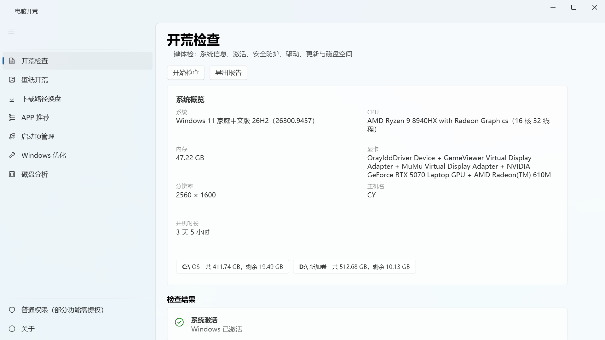
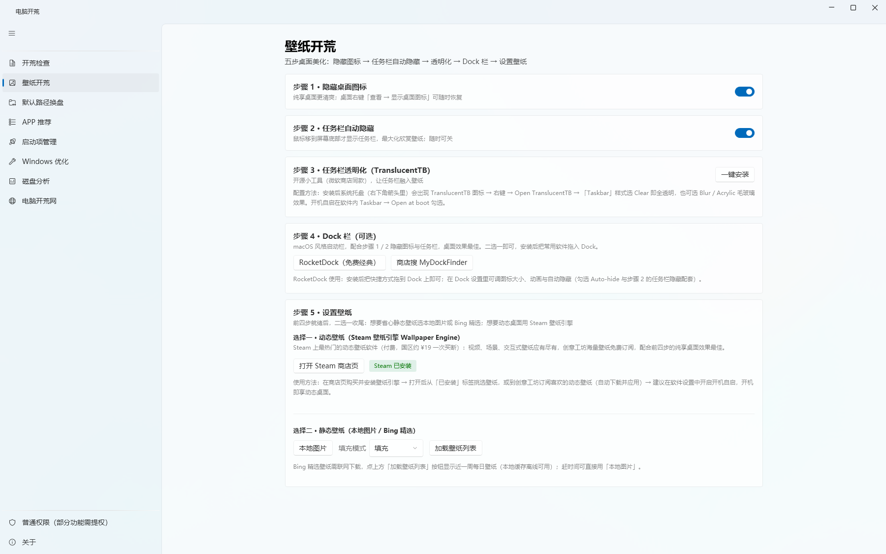
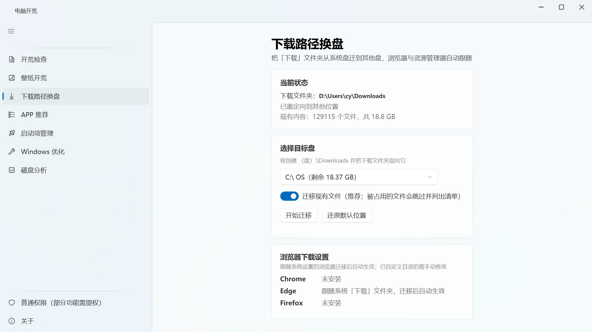
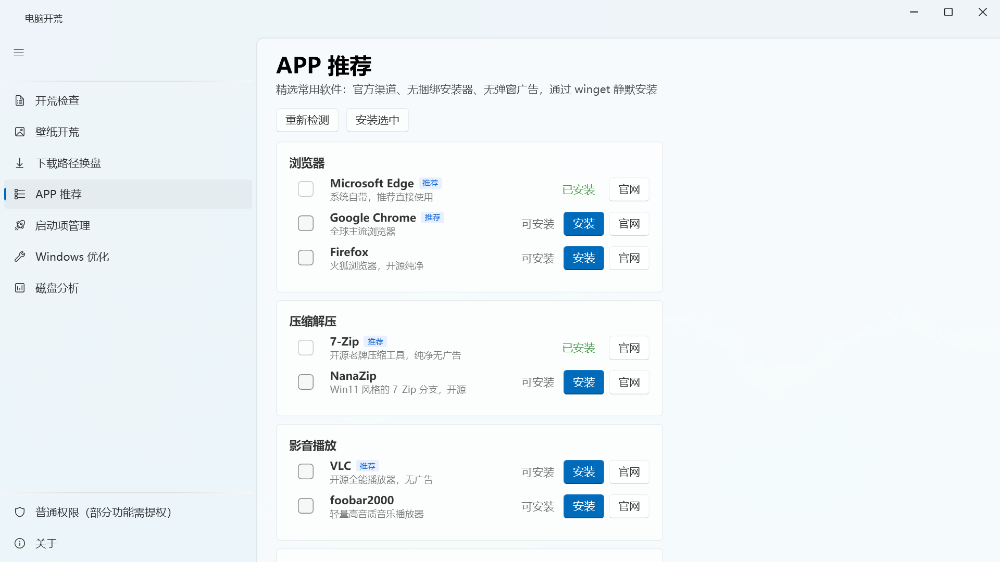
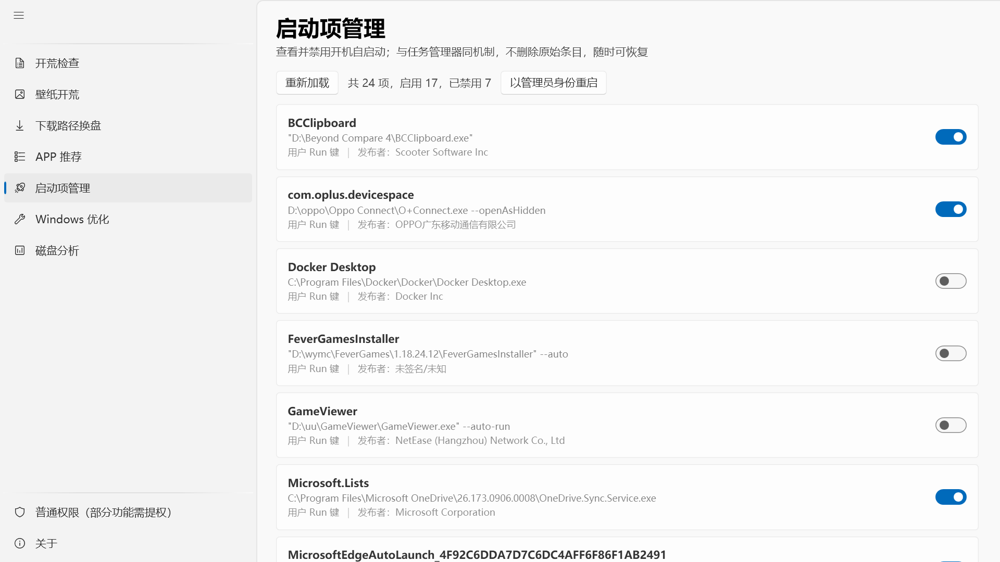
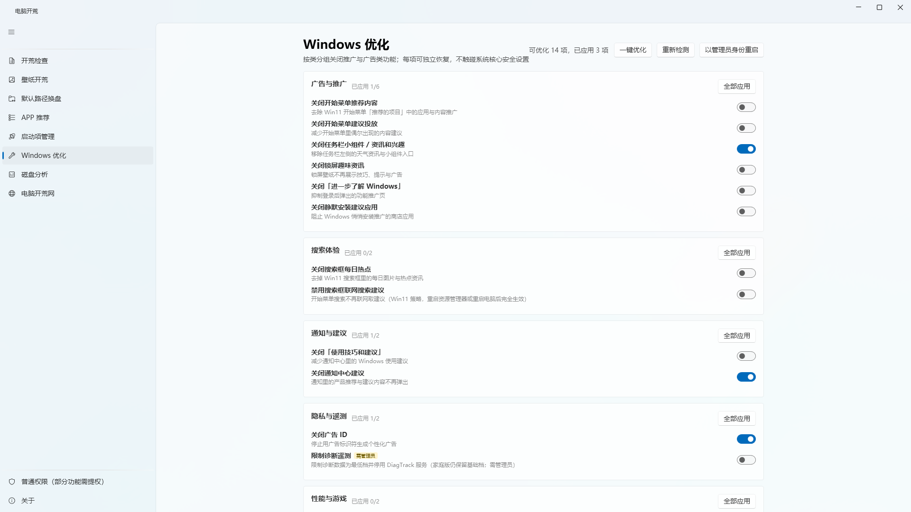
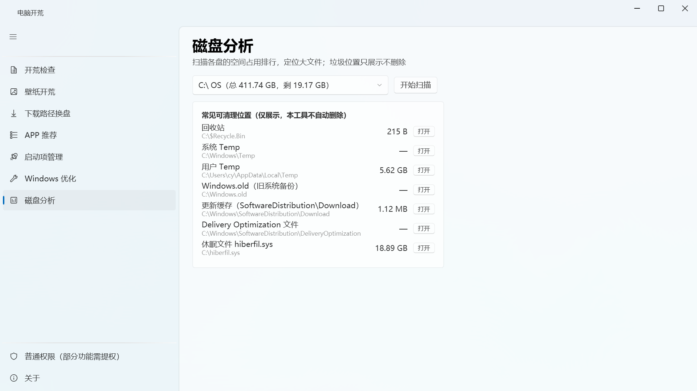
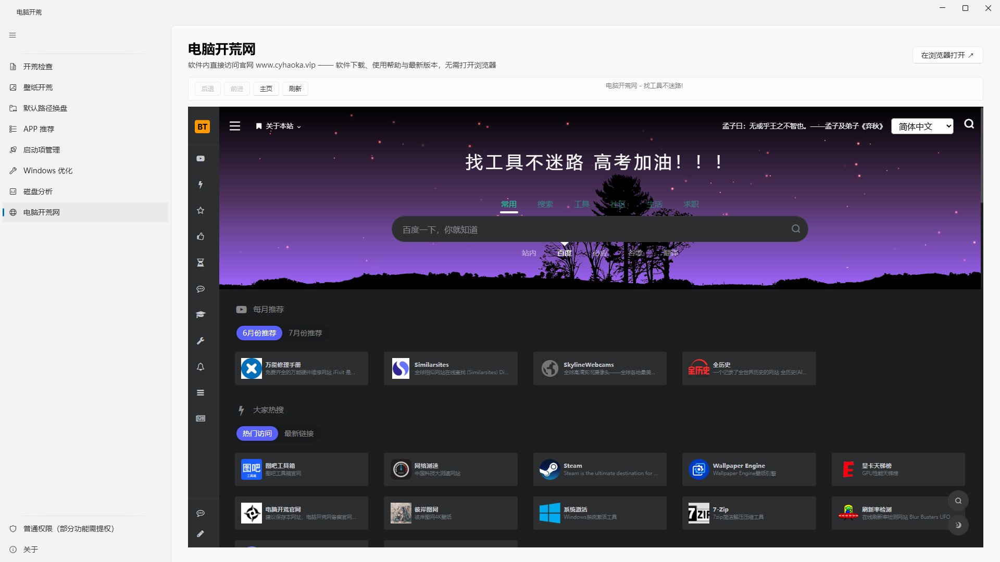
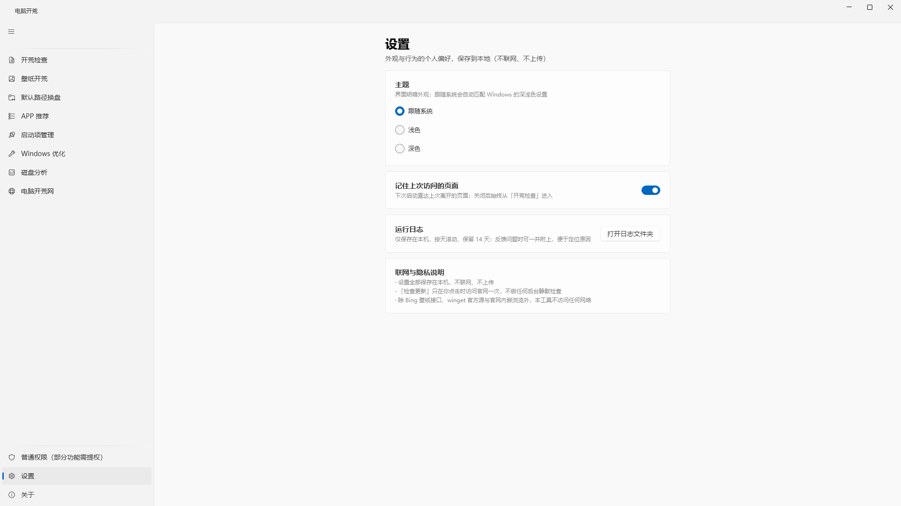
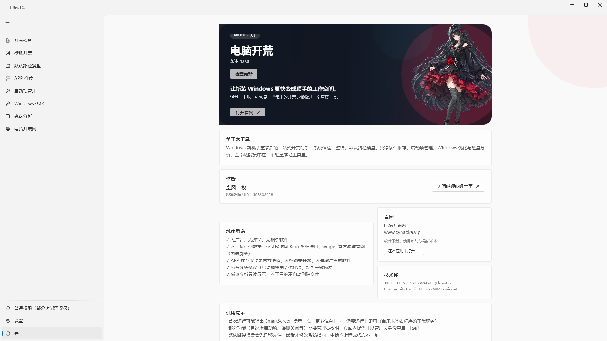

<div align="center">

# 电脑开荒（dnkhw）

**纯净无广告的 Windows 开荒助手**

新机到手 / 重装系统后，体检、壁纸、默认路径换盘、纯净软件安装、启动项管理、
系统优化、磁盘分析、应用内官网——**一个绿色单文件全搞定**。


🌐 **官网：[app.cyhaoka.vip](https://app.cyhaoka.vip)** —— 软件下载、使用帮助与最新版本

</div>

---

## 为什么是「电脑开荒」？

新电脑到手，你是不是也在经历这些：系统体检要开好几个设置页挨个看、壁纸去哪找高清的、
下载文件夹默认堆在 C 盘、装机软件一堆捆绑全家桶、开机启动项越攒越多……

**电脑开荒把这些事做成了一站式流程**，而且坚持三条底线：

- 🚫 **无广告、无弹窗、无捆绑**——软件本身不盈利，也不接任何推广
- 🔒 **不上传任何数据**——仅联网访问 Bing 壁纸接口、winget 官方源与官网（内嵌浏览），别无任何遥测
- ↩️ **一切皆可逆**——启动项禁用、优化项全部可一键恢复；磁盘分析只读，**绝不自动删文件**

## 界面预览

| 开荒检查 | 壁纸开荒 |
|:---:|:---:|
|  |  |
| **默认路径换盘** | **APP 推荐** |
|  |  |
| **启动项管理** | **Windows 优化** |
|  |  |
| **磁盘分析** | **电脑开荒网** |
|  |  |
| **设置** | **关于** |
|  |  |

## 功能特性

### 🔍 开荒检查
一键体检：Windows 版本/CPU/内存/GPU/分区概览，激活状态、Defender 实时保护、防火墙、
异常驱动、待重启、网络连通、电源计划、休眠文件占用——WMI 并行查询，几秒出报告，支持导出 Markdown 或一键复制。
顶部「开荒进度」面板跨模块汇总：体检 / 优化已应用 / 启动项已禁用 / 默认路径已迁移 / 推荐软件已安装，点击直达对应模块。

### 🖼 壁纸开荒
五步桌面美化：隐藏桌面图标 → 任务栏自动隐藏 → 任务栏透明化 → Dock 栏 → 设置壁纸。
收尾二选一：动态壁纸（直达 Steam 壁纸引擎 Wallpaper Engine 商店页，未装 Steam 可一键安装）
或静态壁纸（本地图片，或点击加载 Bing 每日壁纸——可「加载更多」回看约 16 天、可切换中国/国际/日本/英国/德国市场，填充/适应/拉伸/平铺/居中五种模式、离线缓存）。

### 📁 默认路径换盘
把桌面、文档、下载、图片、音乐、视频从系统盘一键迁到其他盘：**先迁移文件、最后才改系统指向**（中断不产生不一致），
迁移过程可随时取消；被占用文件跳过并列出清单；Chrome / Edge / Firefox 下载设置只读检测，跟随系统的自动生效。

### 📦 APP 推荐
精选 32 款软件、10 大类目（含安全防护、截图录屏等），收录标准只有一条：**官方渠道、无捆绑安装器、无弹窗广告**。
已安装自动检测，勾选后 winget 静默批量安装，失败可一键重试；不在 winget 库的一键跳官网。

### 🚀 启动项管理
Run 键 + 启动文件夹全枚举，数字签名发布者解析，支持搜索过滤；
禁用走任务管理器同款 StartupApproved 机制——**不删原始条目，随时可恢复**；
另有「计划任务（登录触发）」「自启动系统服务」只读参考与系统设置直达（只展示不操作，防止误禁系统任务）。

### ⚡ Windows 优化
16 项可逆优化、6 组展示：开始菜单推荐、任务栏小组件、广告 ID、通知建议、联网搜索、Game DVR、
诊断遥测（需管理员）、高性能电源计划、Win11 经典右键菜单等；按 Win10/11 自动显隐，
应用前逐项备份原设置并可精确恢复，支持「全部恢复」一键还原。

### 💾 磁盘分析
一级目录占用排行 + 最大文件 Top 30，进度可取消；
回收站/Temp/Windows.old/更新缓存/休眠文件等常见可清理位置**只展示、不删除**，一键在资源管理器定位。

### 🌐 电脑开荒网
应用内直接访问官网 [app.cyhaoka.vip](https://app.cyhaoka.vip)：WebView2 内嵌渲染（与 Edge 同内核），
无需打开浏览器；提供后退/前进/主页/刷新工具栏与实时状态；
**站外链接自动交给系统默认浏览器**，内嵌仅显示本站内容；无 WebView2 运行时的精简系统会给出安装指引与浏览器兜底。

### ⚙️ 设置与更新
主题三态切换（跟随系统/浅色/深色，即时生效）、「记住上次访问的页面」（下次启动直达）、
打开日志文件夹；关于页「检查更新」**仅在你点击时联网一次**，更新源按
GitHub Releases → Gitee Releases → 官网 version.json 多级回落（开源仓库建好后即接入）；
发现新版可**在线更新**：应用内下载 → SHA256 强校验 → 原地替换 → 重启即用。

## 下载与安装

- **官网下载**：[app.cyhaoka.vip](https://app.cyhaoka.vip)（最新版本与使用帮助）
- **系统要求**：Windows 10（1709+）/ Windows 11，64 位；**无需安装 .NET 运行时**（内嵌官网页依赖系统 WebView2 运行时，Win10/11 一般随系统自带；缺失时应用会给出安装指引或改用浏览器打开）
- **安装方式**：绿色单文件——下载 `Dnkhw.exe` 放到任意目录（建议非系统盘）双击即用
- **校验**：发布说明提供 SHA256，可用 `certutil -hashfile Dnkhw.exe SHA256` 核对

> **首次运行提示**：本工具未购买代码签名证书，Windows 可能弹出 SmartScreen——
> 点「更多信息」→「仍要运行」即可；或右键文件 → 属性 → 勾选「解除锁定」。
> **管理员权限**：默认普通权限运行，需要提权的操作页面内会提示并提供「以管理员身份重启」。

## 技术栈

.NET 10 LTS · WPF · [WPF-UI 4.3](https://github.com/lepoco/wpfui)（Fluent 风格，MIT） ·
[CommunityToolkit.Mvvm](https://github.com/CommunityToolkit/WindowsCommunityToolkit) ·
[WebView2](https://developer.microsoft.com/microsoft-edge/webview2/)（内嵌官网） ·
System.Management (WMI) · P/Invoke（SystemParametersInfo / SHGetKnownFolderPath / SHChangeNotify） ·
[winget](https://learn.microsoft.com/windows/package-manager/)

没有重型框架、没有注入 DLL、没有全局钩子——全部通过官方公开机制完成。

## 从源码构建

前置：Windows + [.NET 10 SDK](https://dotnet.microsoft.com/download/dotnet/10.0)

```powershell
git clone <本仓库地址>
cd dnkhw

dotnet build                     # 构建
dotnet test                      # 运行全部单元测试
dotnet run --project src/Dnkhw   # 启动应用

.\publish.ps1                    # 产出自包含单文件 publish\Dnkhw.exe（当前发布物为 67.61 MB）
```

测试覆盖 Core 业务库的纯逻辑：StartupApproved 编解码（含任务管理器真机样本）、
winget 输出解析、注册表路径构造、下载迁移（临时目录/锁定文件/进度）、
磁盘扫描聚合、路径/参数边界、清单完整性校验、设置读写、更新检查解析、壁纸接口构造等，157 项全部通过。

## 项目结构

```
dnkhw/
├── src/Dnkhw/              # WPF 主程序（WPF-UI Fluent 壳、MVVM、页面与 ViewModel）
├── src/Dnkhw.Core/         # 业务库（UI 无关，可独立复用）
│   ├── SystemCheck/        #   开荒检查（WMI 并行体检）
│   ├── Wallpaper/          #   壁纸（Bing 接口 + SPI 设置）
│   ├── Downloads/          #   默认路径换盘（六个已知文件夹迁移）
│   ├── AppCatalog/         #   APP 推荐（清单 + winget 封装）
│   ├── Startup/            #   启动项（StartupApproved 编解码 + 计划任务/服务枚举）
│   ├── Optimize/           #   Windows 优化（注册表/服务/电源 + 备份还原）
│   ├── DiskScan/           #   磁盘分析（只读聚合）
│   ├── Settings/           #   用户偏好（JSON 原子读写）
│   └── Update/              #   检查更新（version.json 比对）
├── src/Dnkhw.Core.Tests/   # xUnit 单元测试（157 项）
├── tools/Probe/             # 开发探针：真机调用各 Core 服务的控制台工具
├── docs/screenshots/        # 界面截图
├── CHANGELOG.md             # 更新日志
└── promo/                   # 宣传物料（采集/合成脚本、发布说明）
```

## 参与贡献

欢迎 Issue 与 PR：

- 提交前请确保 `dotnet test` 全绿、`dotnet build` 零警告（警告已在构建层强制为错误）
- 新功能请附带单元测试（Core 库的纯逻辑均可测）
- APP 推荐清单（`src/Dnkhw.Core/AppCatalog/apps.json`）接受新条目，但必须满足收录标准：官方渠道、无捆绑、无广告
- UI/UX 改进建议请附截图或原型
- 用户可见变化请同步更新 `CHANGELOG.md`

如果这个工具帮到了你，欢迎点一个 ⭐ Star，这是持续维护的最大动力。

## 许可证

[MIT](LICENSE) © 2026 dnkhw

## 免责声明

- 本工具对系统设置的修改均通过官方公开机制（注册表 / StartupApproved / powercfg / winget），
  并在应用内提供一键恢复；磁盘分析为只读展示，**不删除任何文件**。
- 请仅从本仓库作者发布的官方渠道获取安装包，并通过 SHA256 校验完整性；
  从其他来源获取的文件安全性与作者无关。
- 本软件按「现状」提供，使用产生的一切后果由使用者自行承担。
